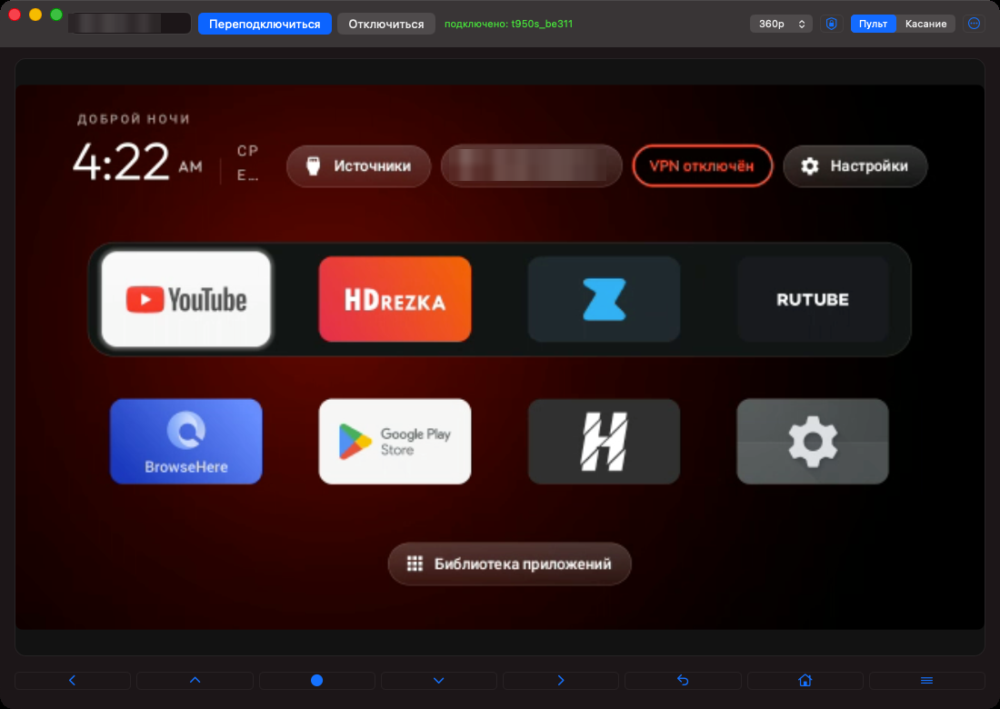

# Приложение «Проектор» для macOS

Удалённое управление проектором прямо с Mac: видно экран, работают мышь и клавиатура.
Подключается по той же Wi-Fi сети, что и проектор.



## Что умеет

- **Видео с экрана проектора** — 640×360 (быстрый режим) или 1280×720, 6–20 кадров/с.
  Частота зависит от того, сколько на экране движения: статичный кадр почти не передаётся.
- **Мышь** — два режима, переключаются кнопкой в верхней панели:
  - **Мышь: пульт** (по умолчанию) — движение мыши превращается в нажатия стрелок.
    Так работает главный экран Android TV: он не принимает касания, фокус двигается
    только стрелками. Клик = «Выбрать».
  - **Мышь: касание** — настоящие тапы и свайпы. Нужны в браузере, YouTube, плеерах —
    там, где интерфейс рассчитан на палец.
- **Клавиатура** — стрелки, Enter, Esc (назад), Tab, Backspace, Home/End, Page Up/Down,
  пробел. Обычный текст уходит в поле ввода на проекторе.
- **Пульт** — восемь кнопок внизу окна: стрелки, OK, «Назад», «Домой», «Меню».
- **VPN** — включает и выключает Happ на проекторе, показывает текущее состояние.
- **Снимок экрана** — меню «Подключение → Снимок экрана» (⌘S).
- **Оформление в стиле macOS** — прозрачный заголовок, панель с материалом
  системы, SF Symbols, сегментированный переключатель режима, скруглённый экран.
  Поддерживаются светлая и тёмная темы, меняется вместе с системой.
- **Кнопка «Отключиться»** — полный разрыв связи с проектором, ⌘D или кнопка в
  верхней панели. Останавливает видео, гасит сервер scrcpy на проекторе, снимает
  проброс портов и завершает локальный сервер adb. После неё к проектору не
  подключено ничего.

## Установка

```bash
cd projector/macapp
./install.sh
```

Скрипт соберёт приложение и положит его в `/Applications`. Запуск:

```bash
open "/Applications/Проектор.app"
```

Адрес проектора вводится в поле слева вверху и запоминается до закрытия окна.
По умолчанию подставляется `192.168.1.50` — замените его на адрес своего
проектора (он же нужен для `adb connect`, см. ниже).

## Требования

- macOS 13 или новее (собрано под Apple Silicon).
- `scrcpy` — из него берётся сервер для проектора:
  ```bash
  brew install scrcpy
  ```
- `adb` из Android platform-tools. Приложение ищет его в стандартных местах,
  в том числе в `/opt/homebrew/share/android-commandlinetools/platform-tools/`.
- На проекторе должна быть включена отладка по сети (она уже включена).

## Как это работает

Внутри — клиент протокола scrcpy, написанный на Swift. Видео и управление идут
по двум отдельным TCP-каналам через adb:

1. Приложение заливает `scrcpy-server` на проектор и запускает его.
2. Сервер кодирует экран через MediaCodec в H.264 и отдаёт по первому сокету.
3. Второй сокет — канал управления: тапы, клавиши, текст уходят туда без задержки
   на запуск процессов.
4. На Mac поток декодируется через VideoToolbox и рисуется в окне.

### Почему не screenrecord

Штатный `screenrecord` на этом проекторе отдаёт кадры только при изменении
картинки и не даёт управление — для удалённого рабочего стола не годится.
`screencap` даёт 0.6 кадра в секунду, это тоже непригодно. Сервер scrcpy
работает через MediaCodec с поверхностью и отдаёт до 20 кадров/с.

### Тонкости протокола, найденные на этом устройстве

- Сервер принимает **ровно два** соединения: первое — видео, второе — управление.
  Подключаться нужно после того, как сервер занял свой сокет, иначе соединение
  занимает место в очереди и сервер завершается.
- Заголовок потока — 81 байт: 1 байт (0) + 64 байта имени + кодек (4) + ширина (4)
  + высота (4). При downscale заголовок **не** обновляется, реальный размер кадра
  берётся из декодированного изображения.
- SPS и PPS передаются **без** старт-кода `00 00 00 01`. Со старт-кодом декодер
  отвечает ошибкой `-12712` (BadData).
- Сервер удаляет свой jar-файл при выходе, поэтому его нужно заливать каждый раз.
- `max_size` ограничивает только длинную сторону; при 640 поток приходит как
  640×360, при 1024 — как 1280×720 (энкодер не любит промежуточные значения).

## Кнопка «Отключиться»

Нажатие рвёт связь полностью, в четыре шага:

1. Останавливается приём видео и оба канала управления.
2. На проекторе завершается сервер scrcpy — он перестаёт кодировать экран.
3. Снимается проброс портов (`adb forward --remove-all`).
4. Гасится локальный сервер adb (`adb kill-server`).

Последний шаг обязателен. Одного `adb disconnect` **недостаточно**: он убирает
запись из списка, но сервер adb держит открытые соединения и через пару секунд
возвращает устройство обратно — проверено, `adb devices` снова показывал `device`.
Только остановка сервера рвёт связь по-настоящему.

Строка состояния после отключения показывает «отключено — доступа к проектору нет».
Вернуться: кнопка «Подключиться» (⌘K).

## Оформление

Интерфейс сделан по правилам оформления macOS, а не «на глаз»:

| Элемент | Как оформлен |
|---|---|
| Заголовок окна | Прозрачный, содержимое уходит под него (как в Finder и QuickTime) |
| Панель управления | Системный материал `.headerView` — размывает фон за собой |
| Кнопки | Нативные `rounded` и `texturedRounded`, без ручной отрисовки |
| Иконки | SF Symbols: они монохромные и подстраиваются под тему |
| Режим мыши | `NSSegmentedControl` — как переключатель в настройках системы |
| Экран | Скруглённая подложка с тонкой рамкой; кадр скруглён по тем же углам |
| Темы | Светлая и тёмная, наследуются от системы автоматически |
| Иконка приложения | Сквиркл с градиентом, лучом и экраном — как у системных программ |

Единая сетка отступов: 16 по краям, 8 и 6 между элементами.

### Иконка приложения

Иконка не лежит готовой картинкой, а рисуется скриптом `make_icon.py`: тёмно-синий
сквиркл, белый экран с кнопкой воспроизведения и конус света от проектора. Форма —
суперэллипс, тот же, что у системных иконок, поэтому в Dock она встаёт в один ряд
с остальными. Пересобрать после правки цветов или композиции:

```bash
python3 make_icon.py       # нужен Pillow; обновляет Проектор.icns
./install.sh               # пересобрать и установить приложение
```

`Проектор.icns` лежит в репозитории, так что для обычной сборки Python не нужен.

Проверить светлую тему на тёмной системе можно переменной окружения:

```bash
PROYEKTOR_THEME=light "/Applications/Проектор.app/Contents/MacOS/Proyektor"
```

### Горячие клавиши

| Клавиши | Действие |
|---|---|
| ⌘K | Подключиться |
| ⌘D | Отключиться (полный разрыв связи) |
| ⌘S | Снимок экрана |
| ← ↑ ↓ → | Стрелки на проекторе |
| Return | «OK» на проекторе |
| Esc | «Назад» |

Return намеренно **не** назначен на кнопку «Подключиться», хотя в диалогах macOS
это обычная практика: здесь Return нажимает «OK» на пульте проектора.

## Если что-то не работает

**«сервер scrcpy не отвечает»** — проверьте, что проектор в сети:
```bash
adb connect 192.168.1.50:5555
adb devices
```
Если устройство пропало из списка, подключитесь заново.

**Видео замерло** — это нормально для статичной картинки: scrcpy не передаёт
одинаковые кадры. Нажмите любую кнопку на пульте в окне, и поток оживёт.

**Мышь не двигает фокус** — вы в режиме «касание», а главный экран Android TV
касаний не понимает. Переключите на «Мышь: пульт».

**Чёрное окно** — сервер не успел отдать первый кадр. Подождите пару секунд или
нажмите «Переподключиться».

## Журнал

Приложение пишет отладочный журнал в `/tmp/proyektor.log`:

```bash
tail -f /tmp/proyektor.log
```

Там видно каждый шаг: заливка сервера, открытие сокетов, размер потока,
частота кадров.
